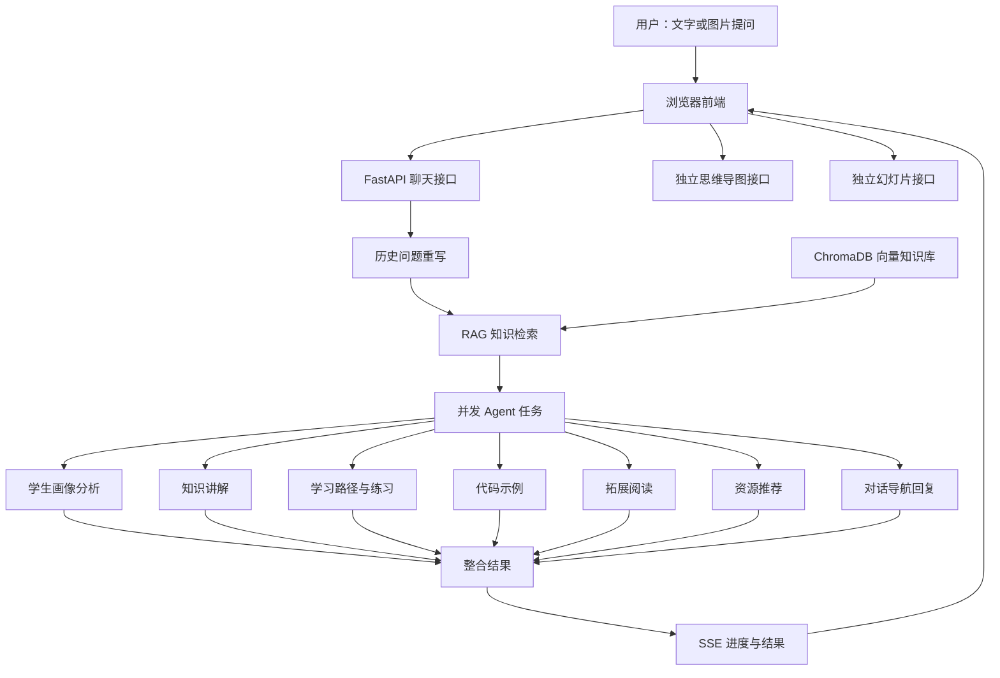

<div align="center">

# 🎓 Multi-Agent Learning Assistant

### 基于多智能体协作与 RAG 的个性化多模态学习助手

**一次提问，获得讲解文档、学习路径、练习题、代码示例、拓展阅读、思维导图与演示文稿。**

[项目简介](#-项目简介) · [功能特性](#-功能特性) · [快速开始](#-快速开始) · [系统架构](#-系统架构) · [接口说明](#-接口说明)

</div>

---

## 📖 项目简介

**Multi-Agent Learning Assistant** 是一款面向自主学习场景的多智能体学习辅助系统。与只返回一段对话答案的传统聊天助手不同，本项目将用户的学习问题分配给多个具有不同职责的 AI Agent，并结合学生学习画像与可选的本地课程知识库，生成不同形式的学习资料。

用户可以通过浏览器输入文字、上传图片进行提问，系统能够组织生成：

- **知识讲解**：结构化 Markdown 课程讲义，支持数学公式。
- **学习规划**：结合学习画像制定学习路径，并附带练习题及解析。
- **代码示例**：为适合编程演示的知识点提供示例代码或伪代码。
- **拓展阅读与资源推荐**：推荐延伸学习方向，提供 B 站、知乎与 CSDN 的关键词搜索入口。
- **可视化内容**：根据指定主题生成 Mermaid 思维导图，或生成可预览、下载的 PPTX 幻灯片。

系统使用 **FastAPI** 提供后端服务，由 **LangChain** 调用兼容 OpenAI 接口格式的大语言模型；使用 **ChromaDB + 本地 Embedding 模型** 支持课程资料检索；前端为无需单独构建的原生 HTML / CSS / JavaScript 页面。

> **项目定位：** 面向学习辅助的原型与实践项目。实际输出质量、运行速度和图像理解效果取决于所配置的模型服务。本文描述仓库代码已实现或接入的能力，不代表所有环境下都已完成端到端验证。

## ✨ 功能特性

| 功能 | 说明 |
| --- | --- |
| 🤖 多智能体协作 | 多个专职 Agent 并发处理一次提问，分别产出学习资料并汇总结果 |
| 👤 六维学习画像 | 从对话中动态推断知识基础、易错点、学习进度、兴趣方向、抗挫折能力与好奇心 |
| 💬 上下文理解 | 结合历史对话进行指代消解与问题重写，支持追问 |
| 🖼️ 图文提问 | 支持上传图片并与文字一起提交给具备视觉能力的模型 |
| 📚 RAG 检索增强 | 基于本地课程 Markdown 文档建立 Chroma 向量索引，检索相关知识片段 |
| 📝 多形式讲解 | 生成课程讲义、学习路径、带答案的练习、代码示例和拓展阅读 |
| 🔗 学习资源入口 | 生成 B 站、知乎、CSDN 的关键词**搜索链接**，而非已核验的具体内容链接 |
| 🧠 思维导图 | 根据主题生成 Mermaid `mindmap`，在浏览器内渲染 |
| 📊 PPT 生成 | 生成结构化幻灯片内容，在网页中预览并通过 PptxGenJS 导出 `.pptx` |
| 🗂️ 会话与主题 | 浏览器本地保存会话、学习资料与全局画像，支持新建、切换、删除会话及明暗主题 |
| 📡 进度反馈 | 通过 SSE（Server-Sent Events）传输任务进度与最终结果 |

## 🏗️ 系统架构



### Agent 职责划分

| Agent / 处理任务 | 主要职责 | 对应实现 |
| --- | --- | --- |
| 学生画像分析 Agent | 根据当前提问及现有画像更新六维学习特征 | `run_profiler_agent` |
| 学习路径规划 Agent | 按画像与检索内容组织学习节点、练习题及解析 | `run_planner_agent` |
| 学科教授 Agent | 生成结构化、偏教材风格的知识讲解 | `get_doc` |
| 代码工程师 Agent | 生成带解释的示例代码与伪代码 | `get_code` |
| 拓展阅读 Agent | 推荐书籍、论文等进一步学习的材料 | `get_ext` |
| 资源推荐 Agent | 提炼关键词，生成面向学习平台的搜索链接 | `get_rec` |
| 对话导航 Agent | 告知用户已生成资源，引导查看不同标签页 | `get_reply` |
| 思维导图生成任务 | 按主题生成 Mermaid 思维导图 | `generate_mindmap_stream` |
| PPT 生成任务 | 按主题、要求和画像生成幻灯片数据 | `generate_ppt_stream` |

> 当前的“多智能体协作”主要采用**角色分工、线程池并发执行、统一汇总输出**的方式；并非 Agent 之间持续相互对话的自治协作网络。思维导图与 PPT 也不在普通聊天的并发任务中，而是由独立接口触发。

### 主要处理流程

1. **输入问题**：用户提交文字、可选图片以及最近几条历史消息。
2. **问题重写**：针对含有“这个”“为什么”等上下文依赖的追问，尝试还原为完整问题。
3. **知识检索**：从可用的本地 ChromaDB 知识库中检索相关课程片段。
4. **并发生成**：通过 `ThreadPoolExecutor` 调度画像更新、讲解、路径、代码等七项任务。
5. **整合结果**：后端通过 SSE 返回进度提示，并在任务完成后返回结构化的最终结果。
6. **前端渲染**：将 Markdown、数学公式和学习资料展示到各自的标签页，并保存浏览器本地会话。

## 🧰 技术栈

| 模块 | 技术 |
| --- | --- |
| 后端服务 | Python、FastAPI、Uvicorn、Pydantic |
| LLM 编排 | LangChain、`langchain-openai`、OpenAI 兼容格式的模型 API |
| 检索增强 | LangChain、ChromaDB、`langchain-chroma` |
| 向量模型 | `sentence-transformers`、`all-MiniLM-L6-v2`、ModelScope |
| 前端 | HTML5、CSS3、原生 JavaScript |
| 内容渲染 | Marked（Markdown）、MathJax（公式）、Mermaid（图表） |
| 演示文稿 | PptxGenJS（浏览器端生成 PPTX） |
| 数据保存 | 浏览器 `localStorage`、本地 ChromaDB |
| 通信方式 | HTTP API、SSE 流式事件 |

## 📁 项目结构

以下列出已核实的核心文件；运行后产生的虚拟环境、向量数据库和下载模型不一定随仓库提交。

```text
Multi-agent_Learning_Assistant/
├── backend/
│   ├── app/
│   │   ├── main.py                 # FastAPI 应用、静态页面与接口路由
│   │   ├── agents.py               # Agent 角色、协作调度及生成逻辑
│   │   ├── schemas.py              # 请求、响应和学习画像数据模型
│   │   └── rag.py                  # ChromaDB 检索逻辑
│   ├── requirements.txt             # Python 依赖
│   ├── download_model.py            # 下载本地 Embedding 模型
│   ├── build_knowledge_base.py      # 从 Markdown 构建本地向量知识库
│   └── .env.example                 # 环境变量模板（请先清理敏感信息）
├── frontend/
│   ├── index.html                   # 单页面应用
│   ├── app.js                       # 页面交互、请求、渲染与 PPTX 导出
│   └── styles.css                   # 页面样式
├── install.bat                      # Windows 初始化脚本
├── start.bat                        # Windows 启动脚本
└── README.md
```

知识库数据和模型的默认位置：

```text
课程复习.md                            # 可选：放在仓库根目录，由用户自行提供
backend/models/all-MiniLM-L6-v2/     # 模型下载后生成
backend/chroma_db/                   # 构建向量数据库后生成
backend/venv/                        # Windows 初始化脚本生成
backend/.env                         # 本地配置文件，不应提交
```

## 🚀 快速开始

### 1. 环境准备

- **操作系统**：仓库提供了 Windows `.bat` 脚本；其他系统可按下方手动命令部署。
- **Python**：建议使用 Python 3.10～3.12，并确保 `python` 和 `pip` 命令可用。
- **Git**：用于克隆仓库。
- **模型服务**：需要一个可访问的、兼容 OpenAI Chat Completions 交互格式的模型接口及有效 API Key。图片提问还要求所选模型具备视觉理解能力。
- **网络**：首次安装需要下载 Python 依赖和 Embedding 模型；LLM 请求以及部分前端 CDN 资源也需要网络连接。

### 2. 克隆项目

```bash
git clone https://github.com/Akariza-mio/Multi-agent_Learning_Assistant.git
cd Multi-agent_Learning_Assistant
```

### 3. 配置课程知识库（可选）

如希望使用 RAG 检索功能，在**仓库根目录**新建 `课程复习.md` 并写入课程资料，例如：

```markdown
# 数据结构

## 二叉树

二叉树是每个结点至多拥有两个子结点的树结构。

## 二叉搜索树

对于二叉搜索树，左子树中的键值小于根结点的键值，
右子树中的键值大于根结点的键值（假设不允许重复键值）。
```

程序会按 Markdown 标题和字符长度分块，使用本地 Embedding 模型生成向量并写入 `backend/chroma_db/`。如未提供该文件，知识库构建脚本会提示找不到输入文档；普通 LLM 生成功能与 RAG 的使用条件不同。

### 4. Windows 一键安装

在项目根目录运行或双击：

```bat
install.bat
```

脚本依次执行：创建 `backend/venv` 虚拟环境、安装 Python 依赖、从 ModelScope 下载 `all-MiniLM-L6-v2`、尝试构建课程向量库，以及在不存在时从 `.env.example` 复制 `backend/.env`。

> 注意：该脚本目前会隐藏大部分命令输出，并可能在某些前置步骤未完成时仍打印成功提示。首次启动失败时建议按照“手动安装”逐步运行命令检查具体错误。

### 5. 配置模型 API

编辑 `backend/.env`，**将所有示例值替换成自己的真实配置**：

```dotenv
# 用于常规问答和资源生成的模型
OPENAI_API_KEY=YOUR_LLM_API_KEY
OPENAI_API_BASE=https://your-llm-provider.example/v1
LLM_MODEL_NAME=YOUR_TEXT_MODEL

# 可选：用于图片理解的视觉模型
VISION_API_KEY=YOUR_VISION_API_KEY
VISION_API_BASE=https://your-vision-provider.example/v1
VISION_MODEL_NAME=YOUR_VISION_MODEL
```

其中 `OPENAI_API_BASE` 与 `VISION_API_BASE` 应按照**所用服务商的实际文档**填写，不一定都是 `/v1` 路径；`LLM_MODEL_NAME` 和 `VISION_MODEL_NAME` 应填写对应服务真实支持的模型标识。

**安全提醒：** 当前仓库公开的 `.env.example` 已出现疑似真实凭证。请项目维护者优先撤销或轮换相关凭证，并将仓库中的模板替换为纯占位符。无论是否已更换，均不要将 `backend/.env` 提交到 Git。

### 6. 启动服务

Windows 系统在完成安装和配置后，运行：

```bat
start.bat
```

或在项目根目录手动运行：

```bat
cd backend
venv\Scripts\python.exe -m uvicorn app.main:app --host 127.0.0.1 --port 8765 --reload
```

在浏览器中访问：**http://127.0.0.1:8765**

FastAPI 会直接托管 `frontend/` 静态文件，**无需额外运行 Node.js 前端开发服务**。

### macOS / Linux 手动安装

如果不使用 `.bat` 脚本，可在克隆仓库之后执行：

```bash
cd backend
python3 -m venv venv
source venv/bin/activate
python -m pip install --upgrade pip
pip install -r requirements.txt
python download_model.py
```

如已在仓库根目录准备 `课程复习.md`，继续执行：

```bash
python build_knowledge_base.py
```

随后自行创建 `backend/.env` 并填写上述模型配置，启动服务：

```bash
python -m uvicorn app.main:app --host 127.0.0.1 --port 8765 --reload
```

## 🧭 使用指南

### 智能学习对话

在“智能对话”标签页输入学习问题，例如：

> 什么是操作系统中的进程调度？请比较 FCFS、SJF 和时间片轮转算法，并给出例题。

程序将生成导航回复，并将课程讲解、学习路径、代码示例、拓展阅读与资源推荐填充到对应标签页。路径规划中包含针对知识点设计的练习及参考解析。

### 图片提问

点击对话输入框旁的图片上传按钮，选择图片并提交问题。前端会以 Data URL 形式将图片和文本一起发送到后端；需要有效的视觉模型配置和支持图片输入的模型服务。

### 生成思维导图

切换到“思维导图”，输入主题并点击“生成导图”。后端将生成 Mermaid `mindmap` 源码，前端使用 Mermaid 渲染；复杂或不合法的生成语法可能造成渲染失败。

### 生成 PPT

切换到“幻灯片PPT”，填写**核心主题**与**具体要求**，点击“生成 PPT”。完成后可以浏览幻灯片，并点击“下载 .pptx 文件”导出。

> 当前 PPT 在浏览器端通过 PptxGenJS 导出。网页中的 Mermaid 流程图不会完整保留到下载的 PPTX 中；动态配图依赖外部图片服务，导出效果可能与网页预览存在差异。

### 学习画像与历史会话

左侧面板显示六维动态学习画像；可新建、切换、删除学习会话，也可重置全局画像。现阶段会话内容、生成资料及画像主要保存在**当前浏览器的 `localStorage`**，并非用户账号云端同步。清除站点数据或更换浏览器后，记录可能无法恢复。

## 🔌 接口说明

服务默认监听 `127.0.0.1:8765`；启动后也可访问 FastAPI 自动生成的接口文档：**http://127.0.0.1:8765/docs**。

| 方法 | 路径 | 功能 | 返回方式 |
| --- | --- | --- | --- |
| `GET` | `/` | 返回前端页面 | HTML |
| `POST` | `/api/chat` | 图文提问、画像更新与学习资源生成 | SSE |
| `POST` | `/api/mindmap` | 根据主题生成 Mermaid 导图 | SSE |
| `POST` | `/api/generate_ppt` | 根据主题与要求生成 PPT 数据 | SSE |

### 1. 学习对话

请求示例：

```json
{
  "message": "请解释二叉搜索树的特点",
  "session_id": "demo-session",
  "current_profile": null,
  "image_base64": null,
  "chat_history": []
}
```

服务返回 `text/event-stream`，事件结构示例如下：

```text
data: {"type":"progress","message":"正在分析您的发言..."}

data: {"type":"result","data":{"reply":"...","updated_profile":{},"learning_path":"...","resources":{"explanation_doc":"...","code_examples":"...","extended_reading":"...","resource_push":"..."}}}

```

其中 `updated_profile` 在实际返回中包含六维字段；`resources` 包含多种内容的 Markdown 文本。**当前实现主要流式传递阶段进度，完整生成内容在最终 `result` 事件中一次返回**，而非逐 token 输出。

### 2. 思维导图

```json
{
  "topic": "计算机网络 TCP 三次握手"
}
```

最终结果包含 `mind_map_mermaid` 字段。

### 3. 幻灯片

```json
{
  "topic": "人工智能的发展历程",
  "requirements": "适合入门课程，约 6 页，结构清晰",
  "current_profile": null
}
```

最终结果包含 `ppt_json` 字段，其值是 JSON 格式的**字符串**，前端解析后预览和导出 PPTX。

## 🔎 RAG 知识库说明

当前实现使用如下流程：

```text
根目录 课程复习.md
    ↓ Markdown 标题切分
    ↓ 字符级分块（chunk_size=800，chunk_overlap=150）
    ↓ 本地 all-MiniLM-L6-v2 Embedding
    ↓ ChromaDB 持久化到 backend/chroma_db/
    ↓ 用户提问时检索相关片段（默认 top-k=3）
    ↓ 将检索结果交给部分 Agent 作为参考
```

**“本地 Embedding / 本地向量检索”不等于“系统完全离线”**：普通对话和内容生成仍会向用户配置的 LLM API 发送请求；视觉识别、CDN 资源与图片服务也可能涉及网络访问。

如果课程资料更新，可在 `backend/` 下重新执行：

```bash
python build_knowledge_base.py
```

## ❓ 常见问题

**Q：安装完成后仍无法检索到本地课程内容？**

A：确认项目根目录存在 `课程复习.md`、Embedding 模型已成功下载，并在 `backend/` 下运行过 `python build_knowledge_base.py`。默认仓库根目录当前未展示该课程文件，因此需要自行提供。

**Q：为什么上传图片后不能正常识别？**

A：检查 `VISION_API_BASE`、`VISION_API_KEY`、`VISION_MODEL_NAME` 是否正确，并确认 API 服务实际支持图像消息格式。

**Q：能否在完全没有网络的情况下使用？**

A：当前代码不提供完整的离线 LLM 推理方案。虽然向量编码和检索可本地运行，但主要生成能力依赖配置的模型服务；要实现完整离线运行，需要接入兼容的本地模型推理服务并处理前端外部资源依赖。

**Q：安装脚本提示成功，但服务无法运行？**

A：`install.bat` 可能屏蔽依赖安装和模型下载的错误输出。请手动激活环境、安装 `requirements.txt`，逐步执行模型下载与知识库构建命令，检查报错。

**Q：生成的推荐链接为什么打开的是搜索结果？**

A：当前资源推荐实现刻意使用平台关键词搜索地址，避免让模型随意编造具体文章或视频链接，因此它并不保证某个搜索结果已被人工验证。

## 🛠️ 开发与改进方向

欢迎围绕以下方向进一步完善：

- 增加自动化测试、统一异常处理与更完整的错误反馈。
- 支持多份课程资料上传、知识库管理与来源引用。
- 改进画像在 PPT 生成等独立功能之间的同步与复用。
- 增加更细粒度的内容流式输出与任务状态展示。
- 完善 PPTX 中的 Mermaid 图表、图片嵌入与版式一致性。
- 优化模型输出内容的校验、Markdown 安全渲染与敏感数据保护。
- 增加跨设备持久化、部署方案和权限控制。

## 🔐 安全与使用声明

- **不要将真实 API Key、访问令牌或个人隐私写入 `.env.example`、代码及其他公开文件。** 已公开的凭证应视作泄露，并在对应服务商处撤销或轮换；只删除最新提交中的字符串不能清除历史泄露风险。
- 建议在 `.gitignore` 中忽略 `.env`、`venv/`、`chroma_db/`、下载模型、日志与其他运行产物。
- 当前前端以 `localStorage` 保存对话记录与图片数据，请避免在公共设备输入敏感信息。
- 学习材料、练习题答案及参考资源由大模型生成，可能存在事实错误，关键结论请自行核验。
- 当前启动脚本仅绑定 `127.0.0.1`；如部署到公网，请先补充鉴权、请求限制、输入校验和安全审计。
